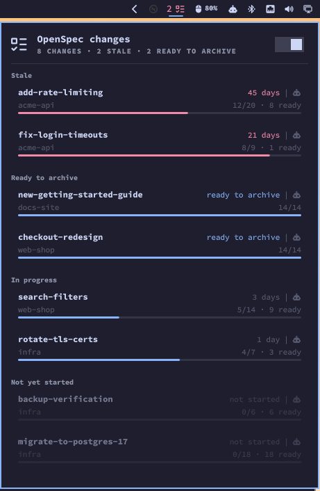

# openspec-pulse

Tells you which OpenSpec changes have gone quiet, across every repo on your machine, so a change doesn't get forgotten altogether.



*The Omarchy panel, with demo data.*

Two parts live in this repo:

- a Ruby CLI, `openspec-pulse`, which does all the work and prints a table or JSON
- an Omarchy shell plugin (bar badge and drop-down panel) that displays the CLI's JSON

## Install

You need Ruby 4.0 (the repo pins it in `mise.toml`), Bundler, `git` and the `openspec` CLI on your PATH.

```sh
git clone https://github.com/jaapie/openspec-pulse.git ~/dev/openspec-pulse
cd ~/dev/openspec-pulse
bundle install
bin/openspec-pulse version
```

`bin/openspec-pulse` finds its own `Gemfile`, so it works from any directory. It isn't published as a gem; the gemspec is there so another Ruby app can use it with `gem "openspec-pulse", git: "https://github.com/jaapie/openspec-pulse.git"`.

If `/usr/bin` comes before mise on your PATH (Arch's `ruby` package installs Ruby 3.4 there), the system Ruby runs it instead and fails with `Bundler::GemNotFound`. Put mise's shims first:

```sh
PATH="$HOME/.local/share/mise/shims:$PATH" bin/openspec-pulse status
```

## Config

The config file is `$XDG_CONFIG_HOME/openspec-pulse/config.yml`, which is `~/.config/openspec-pulse/config.yml` when `XDG_CONFIG_HOME` isn't set. There is no default: without the file the CLI stops with an error naming the path it looked for.

```yaml
# Every directory up to 5 levels below these that has openspec/changes/ is a repo.
# node_modules, .git and vendor are skipped.
scan:
  - ~/code
  - ~/dev

# Repos outside the scan roots (optional). Each is named by its folder name.
repos:
  - ~/elsewhere/tool

# An in-progress change with no commits to its folder for this many days is stale.
stale_after_days: 14

# Your Jira site (optional). A change's Jira task links to <jira_url>/browse/<KEY>.
jira_url: https://example.atlassian.net
```

A change's Jira task is the first key after "Jira:" in the sentences that open a paragraph of its proposal's "## Why" section, for example `Jira: ABC-12 (under epic ABC-1).`

A repo found twice (by two scan roots, or by a scan root and `repos`) is listed once. A scan root or repo that doesn't exist is shown as an error, not skipped.

## `status`

```sh
bin/openspec-pulse status
bin/openspec-pulse status --json
```

`status` prints one row per active change: repo, change, tasks done, days since its folder was last touched, and a note (`stale`, `in progress`, `not started`, `ready to archive`, a read error, or OpenSpec's own counts when they differ from the parsed ones). Rows are ordered stale first (quietest at the top), then complete (ready to archive), then other changes in progress, then not started. Repos that couldn't be read are listed at the end.

`--json` prints the same report as one JSON document for the Omarchy plugin, including each change's task groups and tasks.

How it decides:

- **Last touched** is the time of the latest commit touching `openspec/changes/<name>/`, or now if that folder has uncommitted edits. A folder that has never been committed, or a repo that isn't a git repo, uses the newest file modification time instead.
- **Kind**: `not_started` when no task is ticked (including no tasks at all), `complete` when every task is ticked, otherwise `in_progress`.
- **Stale**: only `in_progress` changes can be stale, so proposals you haven't started never nag.
- **Read-only and careful with other people's repos**: it only runs `openspec list --json` and read-only git commands (`log`, `rev-parse`, `diff-index --cached`, `ls-files`), never `git status`, and it never writes to a repo. A repo's own `.git/config` can name programs for git to run (an fsmonitor, a `gpg.program`, a clean filter); openspec-pulse switches those off or avoids the commands that use them, and spots uncommitted edits by comparing file sizes and times with what git recorded, without git reading the files.

The exit status is 0 whenever a report was produced, even if some repos had errors, and non-zero only when there is no report at all (for example, a missing config).

## `notify`

```sh
bin/openspec-pulse notify
bin/openspec-pulse notify --force
```

`notify` builds the same report as `status` and, when at least one change is stale or ready to archive, sends one desktop notification stating the counts:

```
You have 6 stale OpenSpec changes, and 2 changes ready to archive.
```

A part with nothing in it is left out ("You have 1 stale OpenSpec change." or "You have 2 OpenSpec changes ready to archive."), and nothing is sent when both are zero. The notification doesn't list changes; the details are in the Omarchy plugin's panel and in `status`.

The notification goes through `omarchy notification send`, so `notify` needs Omarchy. It carries a placeholder "OSP" icon and goes away on its own after a few seconds. Clicking it, or its **See more** button, opens the Omarchy plugin's panel, or a floating terminal showing the `status` table when the plugin isn't installed.

It sends at most once per local calendar day, so it's safe to run often (the Omarchy plugin runs it every 5 minutes). The date of the last digest is kept in `$XDG_STATE_HOME/openspec-pulse/last_digest` (`~/.local/state/openspec-pulse/` by default), so a restart doesn't send a second one.

`--force` sends now, even if today's digest has gone or nudges are off. It doesn't record the date, so the normal daily digest still goes out.

If `omarchy notification send` is missing or fails, `notify` exits non-zero with the reason and doesn't record the date, so the next run tries again.

## `nudges`

```sh
bin/openspec-pulse nudges        # prints on or off
bin/openspec-pulse nudges off
bin/openspec-pulse nudges on
```

Turns the daily digest on or off. Nudges are on until you turn them off. The setting is kept in `$XDG_STATE_HOME/openspec-pulse/nudges` and shows in `status --json` as `nudges`. It only affects the notification: `status` and the bar badge still show stale changes.

## Omarchy plugin

The repo is also an Omarchy shell plugin: `manifest.json`, `Service.qml`, `BarWidget.qml` and the panel's QML sit at its root. It adds a badge to the bar and a drop-down panel, and it gets everything from the CLI, so set up the [config](#config) first.

### Install

```sh
omarchy plugin add https://github.com/jaapie/openspec-pulse.git --enable
cd ~/.config/omarchy/plugins/io.github.jaapie.openspec-pulse
bundle install
```

A local clone works as the URL too (`omarchy plugin add ~/dev/openspec-pulse --enable`); `omarchy plugin update io.github.jaapie.openspec-pulse` pulls later commits. If the badge doesn't appear, restart the shell with `omarchy restart shell`. Do the same after an update that changes the panel: the update reloads the plugin, but the shell keeps its cached copy of the panel's QML until it restarts. To uninstall, run `omarchy plugin remove io.github.jaapie.openspec-pulse`. The plugin's id is `io.github.jaapie.openspec-pulse`; the CLI is still called `openspec-pulse`.

### What it shows

- **Badge**: a task-list glyph, with the number of stale changes beside it in the theme's attention colour, or a warning glyph when the CLI or a repo has an error. Hover for a summary.
- **Panel** (click the badge): totals, then changes grouped as stale, ready to archive, in progress and not yet started. The panel stays one size and pages rather than scrolls. Type to narrow the list to changes whose name or repo contains the text; Escape clears the search, and a second Escape closes the panel. On the command line, pipe `status` through `grep` instead. A switch in its header turns the daily reminder on or off, which only affects the notification, not the badge.
- **Change view** (click a change): what the change is for, from the Why section of its `proposal.md` (three lines, then "more"), then its task groups in file order, open tasks listed and done ones folded away, plus buttons to open your default agent in the repo (with `/opsx:apply <change>`, told to check with you before changing anything) or open `tasks.md` in your editor. Hover cut-off text to read all of it.

The plugin runs `status --json` every 5 minutes and whenever the panel opens, and `notify` on the same timer; the CLI decides whether a digest is due. The digest's **See more** opens this panel on the focused monitor.

### PATH and Ruby

The shell doesn't start with mise's PATH, so the plugin runs the CLI with its own:

```
~/.local/share/mise/shims : ~/.local/bin : /usr/share/omarchy/bin : /usr/bin : /bin
```

mise's shims come first so Ruby 4.0 and `openspec` are found ahead of Arch's Ruby 3.4 in `/usr/bin`; `/usr/share/omarchy/bin` is where the notification command lives. The plugin uses `openspec-pulse` if it's on that PATH, and otherwise the copy in its own `bin/`, which is why the plugin folder needs `bundle install`.

If the CLI can't be found or fails, the badge shows its warning glyph and the panel shows the error. It never shows an empty list instead.

### The `command` setting

Without mise, or to use a CLI installed somewhere else, set the widget's `command` setting to the full path of the `openspec-pulse` executable, in the bar widget's settings or in `~/.config/omarchy/shell.json`:

```json
{ "id": "io.github.jaapie.openspec-pulse", "command": "/home/you/bin/openspec-pulse" }
```

The plugin still runs it with the PATH above, so the Ruby it starts with must have the gems installed.

## Roadmap

Ideas, roughly in order. Nothing here is promised.

- **Reminders**: dated reminders to come back to a change (or a task in one), shown as notifications with snooze and dismiss, a "due now" section at the top of the panel, and a second badge. Clicking one opens your agent with a prompt for that change.
- **Faster `status`**: run the `openspec list` calls in parallel and batch the git calls per repo. Most of a run's time today is starting `openspec` once per repo.
- **Options**:
  - show the change list paged, as now, or as one scrolling list;
  - choose where "Open in agent" opens: a new terminal (as now), a new window in a running tmux session, or a new herdr tab.
- **Snoozing a change**: hide a change from the stale count until a date, at most a week ahead.
- **Waiting markers**: mark a task as waiting on someone else, so a change that's blocked doesn't nag.
- **Grouping by repo** in the panel.
- **Reminders away from the desktop**, for when you're not at this machine.
- **Task counting**: OpenSpec also counts lines like `* [ ]` and `1. [ ]` as tasks, while openspec-pulse only counts `- [ ]`. Today a difference shows as a count mismatch; matching OpenSpec may be better.
- **A real icon** (see below).

## Contributing

Issues and pull requests are welcome at [github.com/jaapie/openspec-pulse](https://github.com/jaapie/openspec-pulse): bugs, ideas, or a go at something on the roadmap.

The project's plans (OpenSpec changes and specs) are kept privately, which is what `openspec/config.yaml` refers to. You don't need them to contribute: if OpenSpec reports an unknown store, that's expected.

**Wanted: an icon.** The notification currently uses a placeholder, `assets/icon.png`, which is just "OSP" in white on a transparent background. If you'd like to design something better, a pull request or an issue with a sketch would be lovely. It needs to read well small, on light and dark notification cards.

To work on it:

```sh
git clone https://github.com/jaapie/openspec-pulse.git
cd openspec-pulse
bundle install
bundle exec rspec
```

- The CLI holds all the logic and is built test-first with RSpec: please add a failing spec before the code that makes it pass, and keep `bundle exec rspec` green.
- The QML only lays out what the CLI reports. Check plugin changes with `omarchy plugin validate .`, then try them in the real shell. After `omarchy plugin update`, restart the shell (`omarchy restart shell`) so it picks up panel changes.
- Text shown from the CLI's JSON stays plain text (`textFormat: Text.PlainText`), and plugin strings go in `i18n/en.json`. Translations into other languages are welcome too.
- The tool must stay read-only towards the repos it reads, and must never show an error as "nothing to report".
